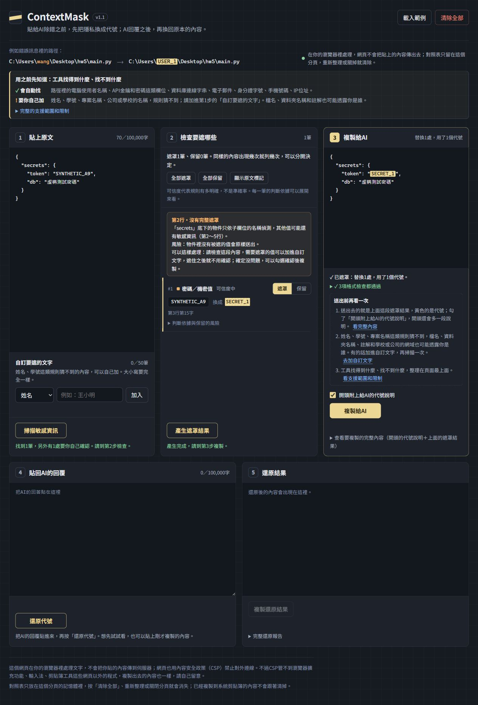

# ContextMask v1.1補充審查

日期：2026-10-11  
執行者：Codex，依專案作者的測試與查錯要求執行。  
檔案：`index.html`，190,499 bytes；SHA-256：`eaea640276ba922709ec166fbb9a4ba7e47123013d5b532d781f691d9a1fd085`。

這輪只審查程式並修訂文件，沒有修改HTML、核心程式或測試程式。作者負責基本操作、使用體驗回饋、方案選擇及提出調整要求；本報告的技術測試由Codex執行。

## 已確認的結果

- 在Windows、Node.js v24.16.0執行`npm test`：原有75項、新增49項全部通過。
- PowerShell設定`$env:FUZZ_N='20000'`後執行`node tests/engine-v1.1.test.cjs`：49項通過，其中隨機測試A、B各20,000組。原始輸出見[測試紀錄](test-logs/codex-review-fuzz-20000.txt)。
- 隨機測試A全部虛構值完整遮罩，有11組額外列為未完整遮罩；B有6,916組包含未完整遮罩的值，均列出確認。這些數字只涵蓋測試模板產生的資料。
- 重新執行`node build.cjs`，產出的HTML與交付檔相同；原始交付包的38筆SHA256SUMS全部符合。
- 上次審查找到的三類問題已修正：呼叫參數換行、YAML欄位名稱加引號的延續行、中括號裡有空白。也檢查了未閉合呼叫字串的提醒。
- 透過本機HTTP頁面操作，確認新增的完整內容、自訂文字、支援範圍三個引導按鈕有效。一般D04案例會先要求確認；勾選後可複製，重新產生後確認重設；用自訂文字完整補遮後可解除確認。

## R07：部分字串被排除，D04可能直接略過確認

優先處理。對應A45。

虛構輸入：

```json
{
  "secrets": {
    "token": "SYNTHETIC_A9",
    "db": "虛構測試密碼"
  }
}
```

不加自訂文字，掃描後直接產生結果。實測`token`換成`SECRET_1`，`db`的字串原樣保留。第2步仍有敏感物件提醒，但第3步沒有要求確認的勾選框，複製按鈕直接啟用。核心結果是`incomplete`為空、未確認的`copyState`仍允許複製；瀏覽器也重現相同行為。

問題不是要求自動辨識中文姓名，而是這裡已經有`secrets`父層線索，依D04應保留確認。`src/app.js`的`objectLeaves()`（原始交付檔第1613～1614行；index.html第2481～2482行）會忽略不含英數字的內容，也把已取出引號內容的字串套用非機密或程式運算式判斷。因此純中文、純符號，以及字串`"false"`、`"demo()"`都可能未被計入覆蓋檢查。

建議：保留值是否帶引號、是否為字串的資訊，不能只憑內容像運算子、布林值或函式就排除。已知敏感物件中的非空字串若未遮住，應保留確認；無法確認完整範圍時，也不能當成已處理。



## R08：200行上限可能把只檢查前段當成全部完成

對應A45。核心測試可重現，這個長案例未另做瀏覽器操作。

重現輸入共207行，可用以下JavaScript產生虛構資料：

```js
const input = 'secrets:\n' +
  Array.from({ length: 205 }, (_, i) =>
    '  item_' + i + '_token: "SYNTHETIC_' + i + '"'
  ).join('\n') + '\n  db: "SYNTHETIC_TAIL"';
```

205個token都被遮住，但最後的`SYNTHETIC_TAIL`仍保留，`incomplete`卻為空，未確認也允許複製。`src/app.js`的`blockEnd()`（原始交付檔第1589行；index.html第2457行）最多查看200行，回傳範圍時沒有把「因上限而停止」留給後續覆蓋檢查。只要前段都遮到，整個物件的確認就可能被移除。

建議：達到行數上限時記錄範圍未完整解析，保留D03確認；不能用已檢查的前段推論整個物件已遮完。另有父欄位與子值中間插入201行註解就完全沒有物件提醒的案例，應一起加入回歸測試。

兩項問題的核心輸出見[補測結果](test-logs/codex-d04-probes.jsonl)。修正時應保留原本正常流程：完整遮住所有值可以解除確認，確實有殘留則由使用者確認後複製，變更輸入後確認失效。

## 隱私檢查與範圍

對HTML及來源做靜態檢查，沒有找到對外請求API、瀏覽器持久儲存、危險HTML字串渲染或原文Console輸出；既有核心測試的CSP雜湊檢查通過。公開文字沒有找到本次檢查使用的已知私人帳號字串；PNG未見文字或EXIF中繼資料，JPG證據圖未見EXIF/XMP標記。規格書的作者姓名仍保留。這些是有限的檢查，不代表所有內容絕對沒有隱私線索。

這輪沒有完整重跑47項瀏覽器自動測試、兩個種子的十萬組測試，也沒有獨立完成file://直接開檔與斷網驗收。Firefox、Safari、Edge、實體手機、螢幕閱讀器與GitHub Pages線上版未納入本輪驗證。Chrome核心的本機HTTP頁面操作不能代替這些驗收。

結論：上次三類漏遮已修正，既有測試通過；目前仍有R07、R08兩項D04確認缺口，不能以測試總數通過取代A45的實際驗收。這輪沒有新增功能需求。

## 後續（看完這份報告之後補的）

R07、R08我要求修正，由Claude修改程式：敏感物件裡引號中的字串不管內容是什麼都算值；物件超過200行、或欄位和值中間隔了超過200行時，一定要確認。這份報告的例子都加進了核心測試和瀏覽器測試，修正後的畫面見`screenshots/desktop-r07-fixed.png`，測試結果見《TEST-REPORT-v1.1》。修正後我又請Codex複審，確認兩個問題都修好了，結果記在《TEST-REPORT-v1.1》的「Codex複審」。
